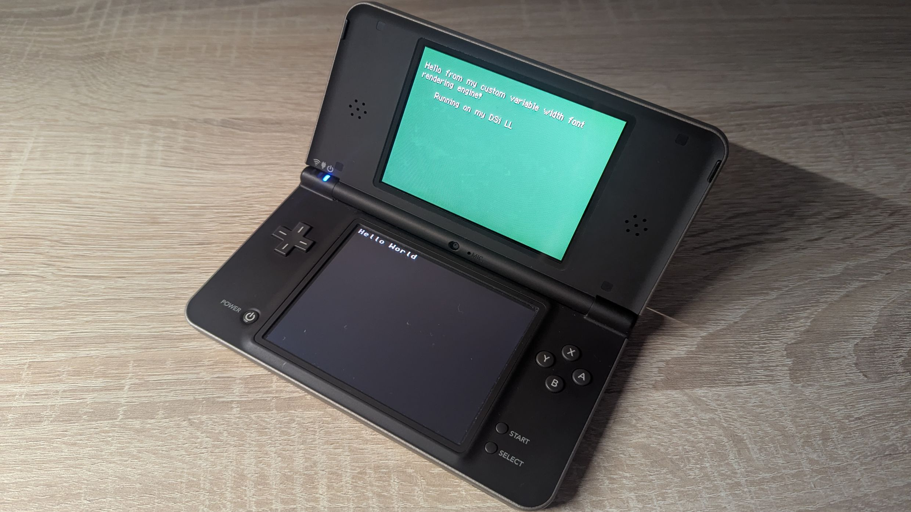

# Variable-Width-Font Generator and Renderer

This repository implements a currently WIP variable-width-font rendering engine for the Nintendo DS, based on the libnds HAL library.
The Library consists of a generator, written in python to produce a binary format with embedded metadata, and a C++ based renderer to allow for swift generation of VWF text on the NDS.

## Current features

In its current state it implements the following features:
- Conversion of an ASCII set of characters from a TTF font to a 1BPP pixel format with character width metadata encoding
- Efficient parsing, shifting and rendering of the characters onto a WRAM buffer
- The Ability to dynamically generate text with a drop shadow or with a set palette color
- Initialization and Copy mechanisms to safely read and write sections of the tilemap and -set to and from the WRAM buffer
- Standardized low-level interface functions, decoupling position of a cursor from the writing of the text to reduce unintended side effects
- Support of fonts up to a total size of 16x16px 

## Pending features

The final version will further include the following features:
- Abstracted interaction functions to map low-level cursor positioning and canvas access to control characters
- Automatic approximation of remaining space in a row and carriage return
- Custom font set definition
- Typewriter letter-by-letter rendering effect of varying speed

